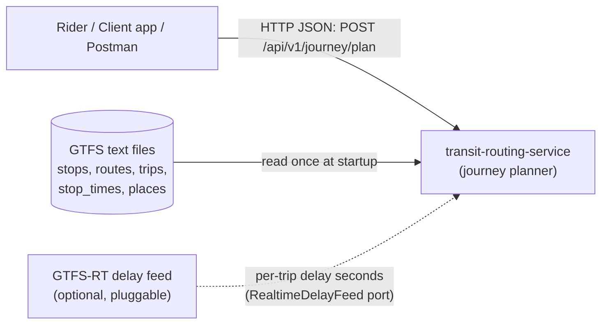
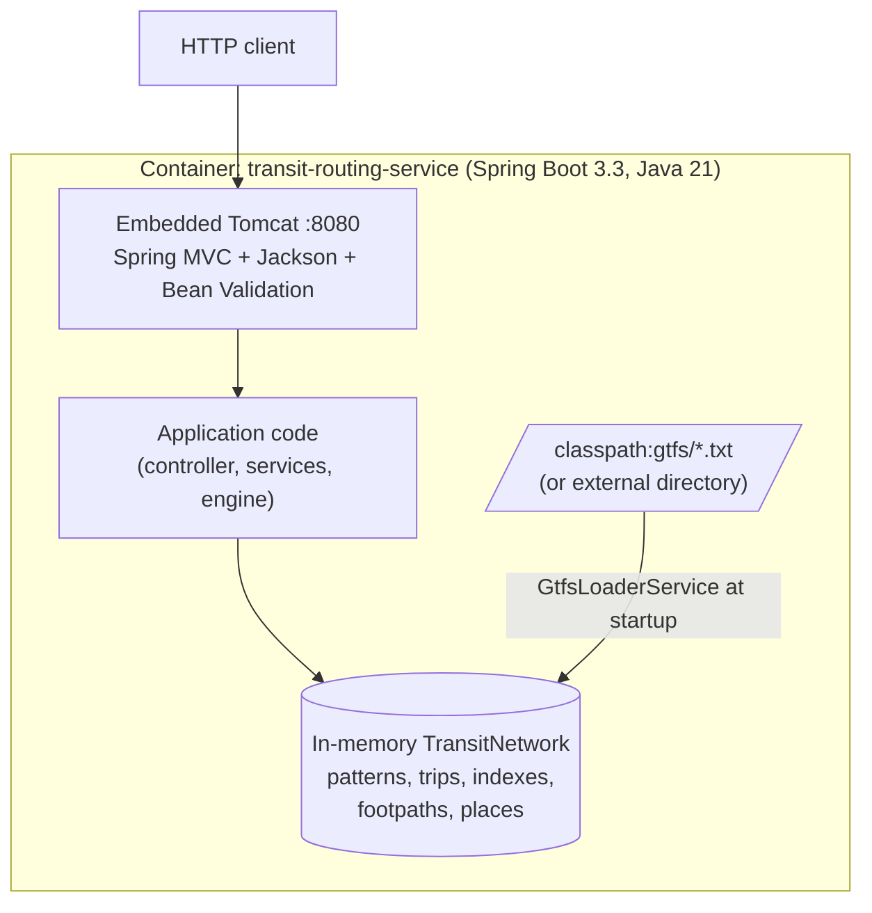
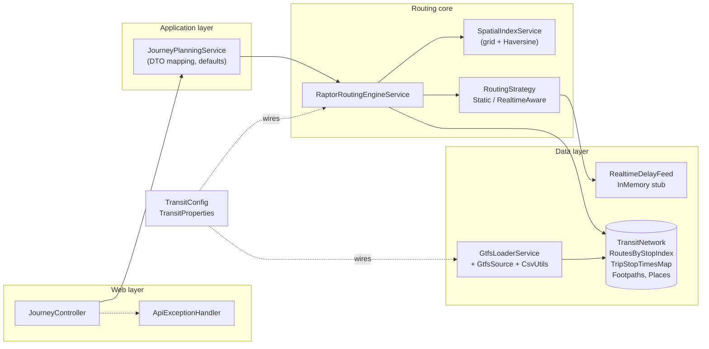
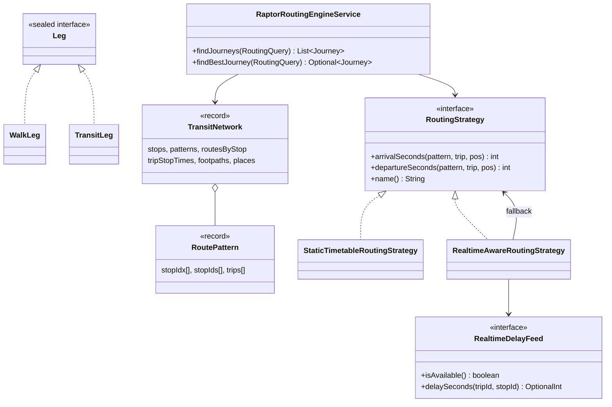
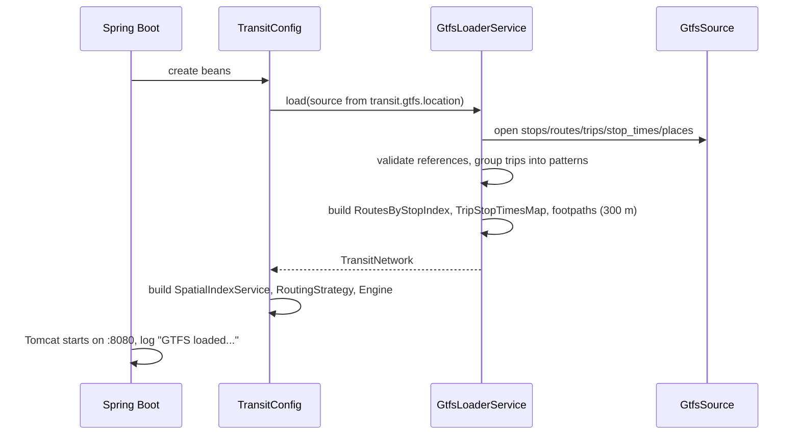
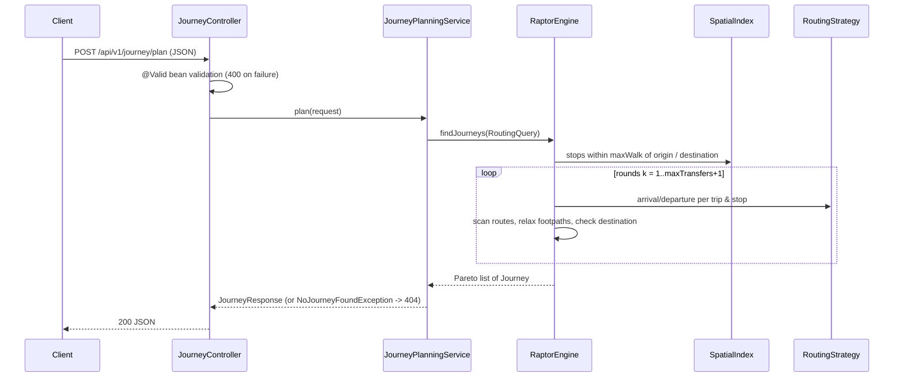
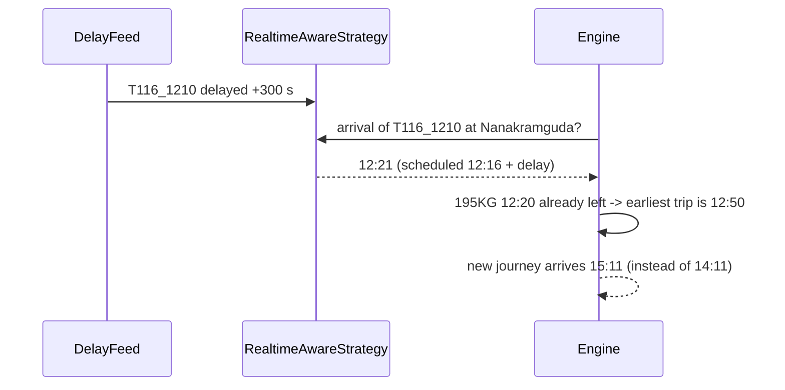
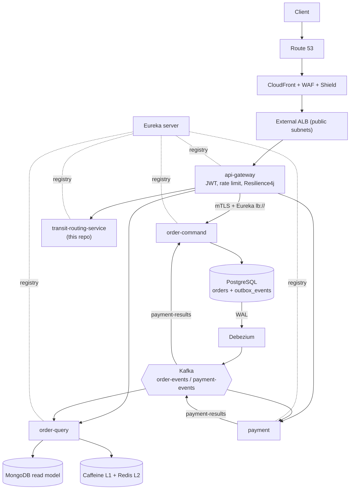
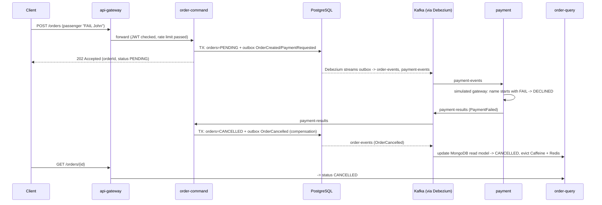

# transit-routing-service

An in-memory **public-transit journey planner**: it parses GTFS files at startup and answers
`POST /api/v1/journey/plan` with a multi-leg itinerary (walk + bus legs + transfers) using the
**RAPTOR** (Round-Based Public Transit Routing) algorithm.

**Stack:** Java 21 · Spring Boot 3.3.5 · Maven · Lombok · Jackson · Bean Validation · JUnit 5

---

## 0. Read this first: what is implemented vs. what is roadmap

This README documents two things and labels them clearly so nobody is misled.

| Topic | Status in this repository |
|---|---|
| GTFS parser, in-memory indexes, spatial index, RAPTOR engine, REST API, real-time fallback strategy | **Implemented** and covered by 28 automated tests |
| Postman collection + testing guide (`postman/`) | **Implemented** |
| Eureka, API Gateway (rate limiting), JWT/OIDC, RBAC/ABAC, Saga, Outbox, Debezium, CQRS, Resilience4j | **Not implemented** (design blueprint in [Part B](#part-b--roadmap-blueprint-not-implemented-in-this-repo)) |
| Route 53, CloudFront, WAF, Shield, ALB, Terraform, Kubernetes manifests | **Not implemented** (design blueprint in Part B) |

Everything in **Part A** describes real code. Everything in **Part B** is a design guide for evolving
the service into a distributed system. Part B contains no claims that the code exists.

---

## Table of contents

**Part A: The implemented service**
1. [Problem and approach](#1-problem-and-approach)
2. [Architecture with the C4 model (Context, Containers, Components, Code)](#2-architecture-with-the-c4-model)
3. [HLD vs LLD](#3-hld-vs-lld)
4. [Component deep-dive (six parameters each)](#4-component-deep-dive)
5. [End-to-end workflow](#5-end-to-end-workflow)
6. [The RAPTOR algorithm as implemented](#6-the-raptor-algorithm-as-implemented)
7. [Design patterns used, when they are invoked](#7-design-patterns-used)
8. [Failure flows](#8-failure-flows)
9. [Running locally](#9-running-locally)
10. [Testing guide](#10-testing-guide)
11. [Configuration reference](#11-configuration-reference)

**Part B: Roadmap blueprint (not implemented in this repo)**
12. [Target distributed architecture and start-up order](#12-target-distributed-architecture-and-start-up-order)
13. [API Gateway rate limiting](#13-api-gateway-with-rate-limiting)
14. [JWT + OAuth2/OIDC](#14-jwt--oauth2oidc)
15. [RBAC and ABAC](#15-rbac-and-abac)
16. [Eureka service discovery](#16-eureka-service-discovery)
17. [Saga + Transactional Outbox + Debezium CDC](#17-saga-with-transactional-outbox-and-debezium-cdc)
18. [Outbox vs Debezium: when to use which](#18-transactional-outbox-vs-debezium-cdc)
19. [CQRS](#19-cqrs)
20. [Circuit breaker](#20-circuit-breaker)
21. [Saga failure flow (payment decline)](#21-saga-failure-flow-payment-decline)
22. [Edge: Route 53, CloudFront, WAF, Shield](#22-edge-route-53-cloudfront-waf-shield)
23. [Terraform: why, and how to read it](#23-terraform)
24. [Kubernetes: how to read it](#24-kubernetes)

---

# Part A: The implemented service

## 1. Problem and approach

Given an origin, a destination and a departure time, find the **earliest-arrival** itinerary over a
schedule-based network, with walking at both ends and between stops.

Why RAPTOR instead of Dijkstra on a graph:

- Transit is **time-dependent** (a bus leaves at 12:10, not "any time"). A time-expanded graph is large.
- RAPTOR works on **routes and trips** directly. It runs in rounds; **round k finds the best arrival using at most k transit trips**, so transfers count falls out naturally.
- It produces a **Pareto set**: fewer transfers vs earlier arrival.
- No priority queue, simple array scans, good cache behavior.

The service is **stateless** at request time. All schedule data is loaded once into an **immutable** in-memory structure, so requests can run concurrently without locks.

---

## 2. Architecture with the C4 model

The "Four C's" are the C4 levels of abstraction: **Context -> Containers -> Components -> Code**. Each level zooms in one step.

### Level 1: System Context (who talks to the system)



- **Actors:** a rider-facing client (mobile app, web, Postman).
- **External data:** GTFS static feed (files); GTFS-RT is an optional extension point (the shipped feed is an in-memory stub).
- **Out of scope today:** accounts, payments, ticketing, maps/geocoding.

### Level 2: Containers (deployable/runnable units)

There is exactly **one container**: a Spring Boot JVM process.



There is **no database, no message broker, no cache server, no service registry**. State lives in the JVM heap.

### Level 3: Components (inside the container)



### Level 4: Code (key types)



### Source layout

```
src/main/java/com/transit/routing
├── TransitRoutingApplication.java        # Spring Boot entry point
├── config/        TransitProperties, TransitConfig, GtfsStartupReporter
├── controller/    JourneyController, ApiExceptionHandler
├── model/
│   ├── gtfs/      Stop, GtfsRoute, Trip, StopTime, Place
│   ├── raptor/    RoutePattern, PatternTrip, PatternStopRef, Footpath, WalkingProfile,
│   │              RoutesByStopIndex, TripStopTimesMap, TransitNetwork
│   └── journey/   Leg (sealed), WalkLeg, TransitLeg, Journey, RoutingQuery,
│                  JourneyRequest, JourneyResponse, LegResponse
├── service/       GtfsLoaderService, GtfsSource, SpatialIndexService, RaptorRoutingEngineService,
│                  JourneyPlanningService, RoutingStrategy (+2 impls), RealtimeDelayFeed (+stub)
└── util/          HaversineDistanceCalculator, TimeUtils, CsvUtils
src/main/resources/application.yml, gtfs/{stops,routes,trips,stop_times,places}.txt
src/test/java/...                         # 28 tests
postman/                                  # collection + testing guide
```

---

## 3. HLD vs LLD

| | High-Level Design (HLD) | Low-Level Design (LLD) |
|---|---|---|
| Question answered | *What are the parts and how do they interact?* | *How does each part work internally?* |
| Covers | C4 levels 1-3, request flow, deployment shape, NFRs | C4 level 4, data structures, algorithms, class contracts, error handling |
| In this README | Sections 2, 4, 5, 12 | Sections 6, 7, 8 and the "Code-level notes" in section 4 |

**HLD summary.** One stateless Spring Boot service. Startup: parse GTFS -> build indexes -> serve. Request: validate -> map to a query -> RAPTOR over the in-memory network -> map to response. Scale out by running more identical instances behind a load balancer.

**LLD summary.**

- Times are `int` seconds since service-day midnight (can exceed 86400 for after-midnight trips).
- Stops are addressed by dense `int` indices; trips by position in a pattern's sorted array.
- A **pattern** = all trips of one route with the *identical* ordered stop list, sorted by first departure (assumes trips on a pattern do not overtake each other, i.e. FIFO).
- Per-query state is local to one call (arrays sized `(maxRounds+1) x stopCount`), so the engine bean has no mutable shared state.

---

## 4. Component deep-dive

Each component is described with the same six parameters.
**Numbers marked "target" are goals to validate with load tests; they are not measurements.** Only the test counts and the benchmark result are measured facts.

### 4.1 REST API layer: `JourneyController` + `ApiExceptionHandler`

1. **Purpose & responsibilities.** Expose `POST /api/v1/journey/plan` (best journey) and `POST /api/v1/journey/plan/alternatives` (Pareto set). Validate input (`@Valid` on `JourneyRequest`), translate exceptions into RFC 7807 `ProblemDetail` responses (400 invalid/malformed, 404 no journey).
2. **KPIs.** Error-rate by class (4xx vs 5xx); share of 5xx (target: ~0%); p95/p99 latency (target: p95 under 100 ms for a city feed, to be load-tested); contract-test pass rate (Postman: 16/16).
3. **Data flow, response time, failure impact.** Client JSON -> Jackson -> Bean Validation -> `JourneyPlanningService` -> JSON. Overhead is typically a few ms. If this layer fails, the service is unreachable (total outage for clients); engine and data remain fine.
4. **Technologies, pros, cons.** Spring MVC + Jackson + Jakarta Validation. *Pros:* declarative validation, standard error format, minimal code. *Cons:* blocking servlet model (one thread per in-flight request); no versioning beyond the `/v1` path.
5. **Scalability & performance targets.** Stateless -> horizontal scaling; Tomcat thread pool (default 200) is the concurrency ceiling per instance. Target: linear throughput scaling with replicas.
6. **Security, reliability, compliance.** *Today:* input range checks only (lat/lon bounds, `maxTransfers` 0-8, `maxWalkDistanceMeters` 50-2000). **No authentication, authorization, TLS or rate limiting.** Request bodies contain location data (personal data under GDPR/DPDP); only `debug` logging of requests exists, keep it off in production.

### 4.2 Application service: `JourneyPlanningService`

1. **Purpose.** Anti-corruption layer between the API contract and the engine: apply defaults (`maxTransfers`=3, `maxWalk`=1000 m), convert `LocalDateTime` to seconds-of-day, call the engine, convert domain `Journey`/`Leg` to `JourneyResponse`/`LegResponse`, raise `NoJourneyFoundException` when empty.
2. **KPIs.** Mapping correctness (benchmark test); zero unhandled exceptions.
3. **Data flow.** `JourneyRequest` -> `RoutingQuery` -> `List<Journey>` -> `JourneyResponse`. Microsecond-level cost. Failure here = wrong/empty responses but engine remains intact.
4. **Tech.** Plain Java with a Java 21 `switch` pattern match over the sealed `Leg` type (compiler-checked exhaustiveness: adding a new leg type forces updating the mapper). *Con:* mapping code must be kept in sync with the DTO.
5. **Scalability.** Pure function, no state, O(legs).
6. **Security/reliability.** No secrets or I/O. Date arithmetic uses the request's own date; see limitation "no calendar" in section 11.

### 4.3 Routing core: `RaptorRoutingEngineService`

1. **Purpose.** Compute Pareto-optimal journeys: access walk -> k rounds of route scanning + footpath relaxation -> egress walk -> journey reconstruction.
2. **KPIs.** Correctness (benchmark: 6 legs, 131 min, 2 transfers, arrival 14:11, asserted in tests); optimality (earliest arrival among journeys with at most k trips); query latency (target p95 under 50 ms on a metro-sized feed); allocations per query.
3. **Data flow, response time, failure.** Reads `TransitNetwork`, `SpatialIndexService`, `RoutingStrategy`. Cost is roughly `O(K x (scanned routes x stops + footpaths))` with `K = maxTransfers + 1` (at most 9). On the bundled 21-stop dataset it is effectively instantaneous. A bug here produces wrong itineraries silently, so it carries the heaviest test coverage (11 tests).
4. **Tech.** Hand-written RAPTOR over primitive `int[]` arrays. *Pros:* no graph build, easy Pareto output, cache-friendly. *Cons:* assumes FIFO trips and no overtaking; no frequency-based (`frequencies.txt`) trips, no calendars, no range queries (profile search).
5. **Scalability.** Per-query memory is `(K+1) x stops x ~5 arrays`; the network itself is shared read-only. CPU-bound: scale by cores/replicas. Target: p99 under 200 ms at the expected peak QPS per instance.
6. **Security/reliability.** Deterministic, side-effect free, thread-safe (no shared mutable state), bounded loops. Query limits (`maxTransfers` ≤ 8, walk ≤ 2000 m) cap worst-case work: **this is also the abuse guard against expensive queries**.

### 4.4 `SpatialIndexService` (uniform grid + Haversine)

1. **Purpose.** "Which stops are within R meters of a coordinate?" for access/egress walks and for precomputing stop-to-stop footpaths.
2. **KPIs.** Recall (no stop within R is missed; unit tests), lookup time (target: under 1 ms).
3. **Data flow.** Coordinates -> candidate grid cells (0.01° ≈ 1.1 km, widened by `cos(lat)` for longitude) -> exact Haversine filter -> list sorted nearest-first. Failure: missing a stop would silently hide journeys, hence the explicit tests (`findsOnlyHeritageFreshNearOrigin`, radius/sort checks).
4. **Tech.** Hash grid. *Pros:* trivial, fast for uniform density, no dependency. *Cons:* an R-tree/H3 index handles very uneven density or huge feeds better; poles/antimeridian not handled.
5. **Scalability.** Build `O(S)`, query ≈ `O(cells x stops per cell)`.
6. **Security/reliability.** Read-only after `rebuild`. Haversine assumes a spherical Earth (error up to ~0.5%), acceptable for walking estimates.

### 4.5 Data layer: `GtfsLoaderService`, `GtfsSource`, `CsvUtils`

1. **Purpose.** Parse `stops/routes/trips/stop_times` (+ optional `places.txt`), validate referential integrity, build the indexes: **patterns**, **`RoutesByStopIndex`** (stop -> routes/patterns), **`TripStopTimesMap`** (trip -> ordered stop times), **footpaths** (stops within 300 m), places.
2. **KPIs.** Startup load time (target: seconds for the bundled data; minutes-scale feeds need a streaming loader), load failures (target 0), rows rejected.
3. **Data flow & failure.** `GtfsSource` (classpath or directory) -> `CsvUtils` -> records -> patterns -> indexes -> `TransitNetwork`. **Fail-fast:** missing files, unknown route/trip/stop references, or missing times throw `GtfsLoadException`, so the application refuses to start rather than serving partial data. Impact: no startup = no service (safe failure).
4. **Tech.** Own minimal CSV reader (quotes, BOM). *Pros:* no dependency, small. *Cons:* no multiline quoted fields, loads everything into memory, no `calendar.txt`/`calendar_dates.txt`, no `frequencies.txt`, no `transfers.txt`.
5. **Scalability.** Heap grows linearly with `stop_times` rows. Large feeds (millions of rows) need heap sizing (`-Xmx`) or a more compact encoding. Reload requires a restart today.
6. **Security/reliability.** Reads only configured paths; no network. Validate any externally supplied GTFS (size limits) before pointing `transit.gtfs.location` at untrusted data. GTFS data licenses (e.g. ODbL/CC) must be respected for real feeds.

### 4.6 `TransitNetwork` (in-memory store)

1. **Purpose.** Immutable, read-optimized store shared by all requests.
2. **KPIs.** Heap footprint; index hit correctness.
3. **Data flow.** Written once by the loader, read concurrently by the engine. O(1) array access by stop index / pattern index.
4. **Tech.** Java `record` holding lists/maps/arrays. *Pros:* thread-safe by immutability, no locking. *Cons:* arrays inside records are not defensively copied (treat as read-only by convention); no incremental update.
5. **Scalability.** Replicated per instance (shared-nothing). 
6. **Reliability.** No persistence: every restart re-parses the feed.

### 4.7 ETA layer: `RoutingStrategy` (`StaticTimetableRoutingStrategy`, `RealtimeAwareRoutingStrategy`, `RealtimeDelayFeed`)

1. **Purpose.** Decide what time a trip arrives/departs at a stop. Static = scheduled time. Real-time-aware = scheduled + delay from a feed; **if the feed is disabled, unavailable or has no data for the trip, it falls back to the static timetable**.
2. **KPIs.** Fallback correctness (identical results with an empty feed: tested); share of queries served with real-time data; feed freshness (when a real feed is plugged in).
3. **Data flow & failure.** Engine calls `arrivalSeconds/departureSeconds` for each candidate trip. Feed outage degrades accuracy, never availability.
4. **Tech.** Strategy + decorator. *Pros:* swap behavior by configuration (`transit.realtime.enabled`). *Cons:* the shipped feed is an in-memory stub with no GTFS-RT protobuf parser; delays are per trip (not per stop); binary search over trips assumes delays keep ordering.
5. **Scalability.** `ConcurrentHashMap` lookups, O(1).
6. **Reliability.** Graceful degradation. A real GTFS-RT adapter must add timeouts and staleness checks, ideally behind a circuit breaker (see section 20).

### 4.8 Configuration & start-up: `TransitConfig`, `TransitProperties`, `GtfsStartupReporter`

1. **Purpose.** Wire beans (loader -> network -> spatial index -> strategy -> engine -> planning service) and log a startup summary: `GTFS loaded: 21 stops, 4 routes, 4 patterns, 15 trips; strategy=STATIC_TIMETABLE`.
2. **KPIs.** Time to ready; config errors at boot (target 0).
3. **Flow.** Spring creates `TransitNetwork` bean (parses GTFS) during context startup; an `ApplicationRunner` then logs stats. Bad config = startup failure (fail-fast).
4. **Tech.** `@ConfigurationProperties` records with `@DefaultValue`. *Pro:* typed, validated, overridable via env/CLI. *Con:* core classes are deliberately annotation-free, so all wiring is in one config class.
5. **Scalability.** N/A. 
6. **Security.** No secrets today. Future secrets must come from env/secret stores, never from `application.yml`.

### 4.9 Utilities: `HaversineDistanceCalculator`, `TimeUtils`, `CsvUtils`

Pure static helpers: great-circle distance, GTFS time parsing (hours may exceed 24), `HH:mm` formatting, CSV splitting. KPI: unit-test pass (3 tests). No I/O, no state, thread-safe, negligible cost.

---

## 5. End-to-end workflow

### 5.1 Startup



### 5.2 One request



### 5.3 The benchmark journey (Gowlidoddy -> RGIA, depart 12:00)

| # | Leg | From -> To | Detail | Time |
|---|---|---|---|---|
| 1 | WALK | Zolo Lakeview PG -> Heritage Fresh | ~600 m, 9 min | 12:00-12:09 |
| 2 | TRANSIT | Heritage Fresh -> Nanakramguda | route `116N/220K`, headsign Koti Medical College, 2 intermediate stops, 6 min | 12:10-12:16 |
| 3 | TRANSIT | Nanakramguda -> Gachibowli X Road | route `195KG`, headsign JNTU, 4 intermediate stops, 13 min | 12:20-12:33 |
| 4 | WALK | Gachibowli X Road -> Gachibowli | ~80 m, 2 min (minimum transfer time) | 12:33-12:35 |
| 5 | TRANSIT | Gachibowli -> RGIA | route `AJ` Pushpak Airport Express, 3 intermediate stops, 79 min | 12:38-13:57 |
| 6 | WALK | RGIA -> Domestic Departures Terminal | ~950 m, 14 min | 13:57-14:11 |

Total **131 min**, **2 transfers** (3 trips). Waiting (12:16-12:20, 12:35-12:38) is not a leg but counts toward the total. The timetable is mock data created to reproduce this benchmark.

---

## 6. The RAPTOR algorithm as implemented

Implemented in `RaptorRoutingEngineService.findJourneys`. Terms: `tau[k][s]` earliest arrival at stop `s` using at most `k` trips; `tauStar[s]` best over all rounds (used for pruning).

```text
Round 0 (access):   for each stop within maxWalk of origin:
                        tau[0][s] = departure + walkTime;  mark s
Direct walk:        if origin->destination <= maxWalk, it is the first candidate

for k = 1 .. maxTransfers+1:
  Q = { route -> earliest marked position }            # from stops marked in round k-1
  for each (route r, position i) in Q:
      trip = none
      for stops p at positions >= i on r:
          if trip != none and arrival(trip,p) < min(tauStar[p], bestDestination):
              tau[k][p] = arrival(trip,p); tauStar[p] = same; mark p   # improved by transit
          if tau[k-1][p] is finite and tau[k-1][p] <= departure(trip,p) (or no trip yet):
              trip = earliest trip at p departing >= tau[k-1][p]       # binary search
  footpaths: for each stop improved by TRANSIT in this round:
      relax neighbours: tau[k][q] = min(tau[k][q], transitArrival + footpathSeconds)
  destination: best over egress stops of tau[k][s] + egressWalk; if better than all previous
               rounds, reconstruct a Journey and add it to the Pareto list
  stop early if nothing is marked
```

Implementation decisions worth knowing:

- **Footpaths only start from transit arrivals**, not from other footpaths (no chained walking). A separate `transitArr` array is kept so reconstruction stays consistent even when a stop is later improved by a footpath.
- **Labels** (`TransitLabel`, `FootLabel`, `AccessLabel`) per round/stop allow walking backwards from the destination to rebuild legs.
- **Walk time** = `distance x 1.2 (detour) / 1.33 m/s`, rounded to whole minutes (min 1); stop-to-stop transfers have a 120 s floor. This is why 600 m = 9 min.
- **Pareto output:** `findJourneys` returns journeys ordered by increasing trips with strictly improving arrival; `findBestJourney` takes the last (earliest arrival).
- **`maxTransfers`** = trips - 1. The benchmark needs `maxTransfers >= 2`.

---

## 7. Design patterns used

Patterns actually present in the code, where they are triggered, and the flow.

| Pattern | Where | When it is invoked | Flow |
|---|---|---|---|
| **Strategy** | `RoutingStrategy` with `Static…` / `RealtimeAware…` | every `arrivalSeconds`/`departureSeconds` call inside route scanning | Config picks the strategy at startup (`transit.realtime.enabled`); the engine only sees the interface |
| **Decorator + Fallback (graceful degradation)** | `RealtimeAwareRoutingStrategy` wraps the static strategy | per time lookup | feed available and has trip delay -> add delay; otherwise delegate to static |
| **Ports & Adapters (Hexagonal)** | `GtfsSource` (classpath/directory adapters), `RealtimeDelayFeed` (in-memory adapter) | at startup (GTFS) and per lookup (delay) | domain code depends on the interface; adapters can be swapped (S3, GTFS-RT) without touching the engine |
| **Dependency Injection / Factory** | `TransitConfig` `@Bean` methods | context startup | builds the object graph; core classes have no Spring annotations, which keeps them unit-testable without a context |
| **Immutable Value Object / Record** | all `model` types, `TransitNetwork` | everywhere | immutability makes concurrent request handling lock-free |
| **Sealed types + pattern matching** | `Leg` -> `WalkLeg`/`TransitLeg`, `switch` in `JourneyPlanningService` | response mapping | exhaustive switch is compiler-verified |
| **DTO / Anti-corruption layer** | `JourneyRequest`/`JourneyResponse`/`LegResponse` vs domain `Journey`/`Leg` | each request | API contract can evolve independently of the engine |
| **Read-only in-memory repository + inverted index** | `TransitNetwork`, `RoutesByStopIndex`, `TripStopTimesMap` | engine reads | stop -> routes lookup gives RAPTOR its marked-stop queue |
| **Spatial index (grid)** | `SpatialIndexService` | per request (access/egress), startup (footpaths) | cell lookup then exact Haversine filter |
| **Exception translation (`@RestControllerAdvice`)** | `ApiExceptionHandler` | when validation/parse/no-journey errors occur | domain exception -> HTTP status + problem detail |
| **Fail-fast** | `GtfsLoaderService` | startup | invalid data aborts boot rather than serving wrong routes |
| **Template of rounds / Pareto pruning** | RAPTOR loop | per request | each round only improves on `tauStar` |

Distributed-systems patterns (gateway, discovery, saga, outbox, CDC, CQRS, circuit breaker) are **not** in the code; see Part B.

---

## 8. Failure flows

### 8.1 Failure cases in this service

| Case | Where detected | Response | Notes |
|---|---|---|---|
| Field out of range, e.g. `maxTransfers: 99` | Bean Validation | **400** `maxTransfers: must be less than or equal to 8` | no engine work done |
| Missing `departureTime` | Bean Validation | **400** `departureTime: must not be null` | |
| Malformed JSON / bad date format | Jackson | **400** `Malformed JSON request body` | |
| No stop within walking radius | Engine (round 0 empty) | **404** `No journey found...` | e.g. `maxWalkDistanceMeters` = 500 or origin (0,0) |
| Too few transfers allowed | Engine (no destination reached) | **404** | `maxTransfers` = 1 for the benchmark |
| Departure after last service | Engine (no trip departs late enough) | **404** | e.g. 23:00 |
| Bad/missing GTFS file or dangling reference | Loader | **application fails to start** (`GtfsLoadException`) | fail-fast |
| Real-time feed empty/unavailable | Strategy | **200** using static timetable | graceful degradation |
| Real-time delay makes a connection impossible | Engine | **200** with a later connection | e.g. delaying trip `T116_1210` by 5 min -> misses the 12:20 `195KG`, boards 12:50, arrives 15:11 (tested) |

### 8.2 Flow: connection missed due to delay



The "passenger name starting with `FAIL` declines payment" scenario belongs to the order/payment saga design, which does not exist in this repo. The equivalent flow is documented in [section 21](#21-saga-failure-flow-payment-decline).

---

## 9. Running locally

This is **one** service with **no external dependencies**: no Eureka, gateway, database or Kafka. The "start order" is simply: *start the app*.

### 9.1 Prerequisites

- JDK 21 or newer (`java -version`)
- Maven 3.9+ (`mvn -v`)
- Optional: Postman, `curl`

### 9.2 Steps

```bash
# 1. Get the code
git clone https://github.com/coder-stat920715/transit-routing-service.git
cd transit-routing-service

# 2. Build and run the tests (28 tests)
mvn clean install

# 3. Start the service
mvn spring-boot:run
#   (optional wrapper: mvn -N wrapper:wrapper   then   ./mvnw spring-boot:run)

# 4. Look for this log line (about 5 s after start)
#   GTFS loaded: 21 stops, 4 routes, 4 patterns, 15 trips; strategy=STATIC_TIMETABLE
```

If port 8080 is busy: `mvn spring-boot:run -Dspring-boot.run.arguments=--server.port=9090`.

### 9.3 First request

Linux/macOS/Git Bash:

```bash
curl -s -X POST http://localhost:8080/api/v1/journey/plan \
  -H "Content-Type: application/json" \
  -d '{"originLatitude":17.4415,"originLongitude":78.3482,
       "destinationLatitude":17.2403,"destinationLongitude":78.4294,
       "departureTime":"2026-10-31T12:00:00","maxTransfers":3,"maxWalkDistanceMeters":1000}'
```

Windows PowerShell:

```powershell
$body = @{ originLatitude=17.4415; originLongitude=78.3482; destinationLatitude=17.2403;
           destinationLongitude=78.4294; departureTime="2026-10-31T12:00:00";
           maxTransfers=3; maxWalkDistanceMeters=1000 } | ConvertTo-Json
Invoke-RestMethod -Method Post -Uri http://localhost:8080/api/v1/journey/plan `
  -ContentType "application/json" -Body $body | ConvertTo-Json -Depth 6
```

(In plain `cmd`, use Postman: quoting JSON in `cmd` is error-prone.)

### 9.4 Common problems

| Symptom | Fix |
|---|---|
| `cannot find symbol: variable log` at compile time | Lombok processor not running on newer JDKs: ensure `maven-compiler-plugin` lists Lombok in `annotationProcessorPaths` (the repo `pom.xml` does), and enable annotation processing + Lombok plugin in IntelliJ |
| `GtfsLoadException` at startup | a GTFS file is missing/invalid; message names the file and row |
| 404 on the benchmark | check `maxTransfers >= 2`, `maxWalkDistanceMeters >= 950`, departure before ~13:40 |

---

## 10. Testing guide

### 10.1 What exists

| Test class | Tests | What it proves |
|---|---|---|
| `RaptorRoutingEngineServiceTest` | 11 | benchmark itinerary (all 6 legs), chronological consistency, later departure (arrival 15:11), transfer limits, Pareto set, no service after hours, walk radius, direct walk, real-time fallback, delay shifts arrival, delay causes missed connection |
| `GtfsLoaderServiceTest` | 7 | entity counts, routes-by-stop index (Nanakramguda has `R116` and `R195`), chronological trips, footpath Gachibowli X Road <-> Gachibowli (≈80 m, 120 s), pattern sorting, missing file and unknown stop failures |
| `SpatialIndexServiceTest` | 3 | radius, nearest-first ordering, empty result |
| `UtilsTest` | 3 | Haversine, GTFS time parse/format, CSV quoting |
| `JourneyControllerIntegrationTest` | 4 | full HTTP stack with MockMvc: benchmark JSON, 404, 400, alternatives |

Run: `mvn test` (28 tests).

### 10.2 Step-by-step manual walkthrough (learn the flow by doing)

1. **Start the app** (section 9). Confirm the startup log.
2. **Happy path.** Send the benchmark request. Verify 6 legs and `arrivalTime 2026-10-31T14:11:00`.
3. **Understand waiting.** Compare leg 2 end (12:16) and leg 3 start (12:20); the 4-minute wait is inside `totalDurationMinutes` (131).
4. **Change the departure time** to `12:45:00`. First bus becomes 13:10 and arrival 15:11 (RAPTOR picks the *earliest catchable* trip).
5. **Limit transfers.** `maxTransfers: 1` -> 404. `maxTransfers: 2` -> 200. This shows the "round k = k trips" semantics.
6. **Limit walking.** `maxWalkDistanceMeters: 500` -> 404 (nearest stop is ~600 m).
7. **After-hours.** `23:00:00` -> 404.
8. **Validation.** `maxTransfers: 99` -> 400; remove `departureTime` -> 400; send broken JSON -> 400.
9. **Alternatives endpoint.** `POST /api/v1/journey/plan/alternatives` returns an array (one entry for the mock data).
10. **Edit the data.** Add a faster trip to `stop_times.txt`/`trips.txt`, restart, and see the itinerary change.
11. **Use your own GTFS.** `--transit.gtfs.location=/path/to/gtfs` (folder with the four required files; optional `places.txt`).

### 10.3 Postman / newman

`postman/transit-routing-service.postman_collection.json` has 16 requests (happy path, routing constraints, validation) with assertions. See `postman/TESTING_GUIDE.md`.

```bash
newman run postman/transit-routing-service.postman_collection.json --env-var baseUrl=http://localhost:8080
```

---

## 11. Configuration reference

| Property | Default | Meaning |
|---|---|---|
| `server.port` | `8080` | HTTP port |
| `transit.gtfs.location` | `classpath:gtfs` | GTFS source: `classpath:<dir>` or an absolute directory |
| `transit.walking.speed-mps` | `1.33` | walking speed |
| `transit.walking.detour-factor` | `1.2` | multiplier from straight-line to street distance (time only) |
| `transit.walking.footpath-radius-meters` | `300` | max stop-to-stop walking transfer |
| `transit.walking.min-transfer-seconds` | `120` | floor for stop-to-stop transfers |
| `transit.realtime.enabled` | `false` | wrap static timetable with real-time-aware strategy |

Known limitations: no `calendar.txt` (all trips run every day), no `frequencies.txt`, no `transfers.txt`, no authentication, no persistence, restart needed to reload GTFS, distances reported are straight-line.

---

# Part B: Roadmap blueprint (not implemented in this repo)

> Everything below is a **design guide**. No Eureka server, gateway, Kafka, Debezium, Terraform or
> Kubernetes file exists in this repository. Snippets are illustrative starting points, not
> tested project code. The order/payment names (`order-command`, `order-query`, `payment`) come from a
> reference microservices template; they are used here because the patterns are easiest to explain with
> them. For this project, `transit-routing-service` would play the role of a **query-side service**.

## 12. Target distributed architecture and start-up order

### 12.1 Reference request flow

```text
Route 53 -> CloudFront + WAF + Shield -> external ALB (L1, public subnets) -> api-gateway
        -> (mTLS, Eureka client-side LB, Resilience4j) -> order-command / order-query / payment (L2, private subnets)
order-command -> PostgreSQL (orders + outbox_events) -> Debezium (WAL) -> Kafka order-events / payment-events
order-query   <- Kafka order-events -> MongoDB read model, L1 Caffeine + L2 Redis cache
payment       <- Kafka payment-events (@RetryableTopic, DLT payment-events.DLT) -> payment-results -> order-command
```



How the transit service fits: it is a read-heavy, CPU-bound query service. Natural extensions are (a) a GTFS-RT ingester publishing delay events to Kafka, which a `RealtimeDelayFeed` adapter consumes (the interface already exists), and (b) running it as stateless replicas behind the gateway.

### 12.2 Local start-up order (sequential)

Services need what they depend on to be up first. Recommended order:

| Step | Start | Why this position | Verify |
|---|---|---|---|
| 1 | **Infrastructure** via Docker Compose: PostgreSQL (with `wal_level=logical`), Kafka (+ topics), MongoDB, Redis, Kafka Connect with Debezium | everything else connects to them | ports open; `docker compose ps` healthy |
| 2 | Register Debezium connector (REST call to Kafka Connect, section 17) | needs Postgres + Kafka; creates the CDC stream | `GET /connectors/<name>/status` is RUNNING |
| 3 | **Eureka server** (`:8761`) | the registry must exist before clients register | open `http://localhost:8761` |
| 4 | **Business services**: `transit-routing-service`, `order-command`, `payment`, `order-query` (any order among them) | register with Eureka, connect to DB/Kafka | all appear UP in the Eureka dashboard |
| 5 | **API Gateway** (`:8080`) | last, so its route table can resolve every `lb://` target immediately | route to a service returns 200 through the gateway |

Starting the gateway *earlier* (right after Eureka) also works: the gateway re-fetches the registry (default every 30 s), so early requests may fail with 503 until services appear. Starting it last avoids that window.

---

## 13. API Gateway with rate limiting

**How it would be implemented (Spring Cloud Gateway + Redis).** Rate limiting is a gateway filter using the **token bucket** algorithm: each caller key has a bucket that refills at `replenishRate` tokens per second up to `burstCapacity`; each request consumes `requestedTokens`. An empty bucket returns **HTTP 429**. Redis holds bucket state so all gateway replicas share limits.

```yaml
spring:
  cloud:
    gateway:
      routes:
        - id: transit-routing
          uri: lb://transit-routing-service
          predicates:
            - Path=/api/v1/journey/**
          filters:
            - name: RequestRateLimiter
              args:
                redis-rate-limiter.replenishRate: 20     # steady 20 req/s per key
                redis-rate-limiter.burstCapacity: 40     # short bursts up to 40
                redis-rate-limiter.requestedTokens: 1
                key-resolver: "#{@userKeyResolver}"
```

```java
@Bean
KeyResolver userKeyResolver() {   // limit per authenticated user, fall back to client IP
    return exchange -> Mono.justOrEmpty(exchange.getRequest().getHeaders().getFirst("X-User-Id"))
        .switchIfEmpty(Mono.just(exchange.getRequest().getRemoteAddress().getAddress().getHostAddress()));
}
```

Layered defense: WAF rate-based rule (coarse, per IP, at the edge) -> gateway limiter (per user/API key, business-aware) -> service-side bounds (already present: `maxTransfers` ≤ 8, walk ≤ 2000 m).

## 14. JWT + OAuth2/OIDC

**Flow.** Client authenticates with an OIDC provider (Keycloak, Amazon Cognito, Auth0) using Authorization Code + PKCE -> receives an **access token (JWT)** -> calls the gateway with `Authorization: Bearer <jwt>`. The gateway is an **OAuth2 Resource Server**: it verifies signature (public keys from the provider's JWKS endpoint), `iss`, `aud`, `exp`, then forwards the request (and optionally identity headers) to services. Services should **re-validate** the JWT (defense in depth) rather than trusting headers.

```yaml
spring:
  security:
    oauth2:
      resourceserver:
        jwt:
          issuer-uri: https://idp.example.com/realms/transit   # JWKS discovered from here
```

```java
@Bean
SecurityWebFilterChain security(ServerHttpSecurity http) {
    return http
        .authorizeExchange(a -> a.pathMatchers("/actuator/health").permitAll()
                                 .anyExchange().authenticated())
        .oauth2ResourceServer(o -> o.jwt(Customizer.withDefaults()))
        .build();
}
```

Use short-lived access tokens (5-15 min) and refresh tokens at the client. Never log tokens.

## 15. RBAC and ABAC

- **RBAC (role-based):** permissions follow roles in a token claim (`roles: ["USER","ADMIN"]`). Map the claim to authorities with a `JwtAuthenticationConverter`, then `@PreAuthorize("hasRole('ADMIN')")` or `.pathMatchers(HttpMethod.DELETE, "/admin/**").hasRole("ADMIN")`.
- **ABAC (attribute-based):** decisions use attributes of the **subject, resource, action and environment** (owner id, tenant, order status, time of day, IP range). Implemented with a policy bean called from method security:

```java
@PreAuthorize("hasRole('USER') and @orderPolicy.canView(authentication, #orderId)")
public OrderView get(@PathVariable String orderId) { ... }

@Component("orderPolicy")
class OrderPolicy {
    boolean canView(Authentication auth, String orderId) {
        String userId = ((Jwt) auth.getPrincipal()).getSubject();
        return orderRepo.ownerOf(orderId).equals(userId)             // resource attribute
            || auth.getAuthorities().contains(new SimpleGrantedAuthority("ROLE_SUPPORT"));
    }
}
```

Use RBAC for coarse capability ("can use admin API"), ABAC for fine-grained rules ("only the owner, only while status is PENDING").

## 16. Eureka service discovery

- **Server:** a Spring Boot app annotated `@EnableEurekaServer` (`server.port=8761`, `eureka.client.register-with-eureka=false`, `fetch-registry=false` for a standalone node).
- **Clients:** `spring-cloud-starter-netflix-eureka-client`; `spring.application.name=transit-routing-service`; `eureka.client.service-url.defaultZone=http://localhost:8761/eureka`.
- **Mechanics:** instances register, send a **heartbeat every 30 s**, and are evicted after ~90 s of silence. Clients cache the registry and refresh periodically. The gateway/other services call `lb://transit-routing-service`; **Spring Cloud LoadBalancer picks an instance client-side** (round-robin by default), so there is no central proxy hop.
- **Trade-offs:** registry data is eventually consistent (stale entries possible); self-preservation mode can keep dead instances listed during network partitions; run 2-3 Eureka peers in production. On **Kubernetes**, native Services/DNS replace Eureka, so you would not run both.

## 17. Saga with Transactional Outbox and Debezium CDC

**Problem.** Placing an order touches several services (order, payment). A distributed ACID transaction is impractical, so use a **Saga**: a sequence of local transactions with **compensating actions** on failure.

**Style used by the reference flow: choreography.** Services react to each other's events (no central coordinator). (Orchestration uses a coordinator that commands each step; easier to trace, more coupling.)

**Why Outbox.** A service must update its DB **and** publish an event atomically. Writing to the DB then to Kafka (dual write) can lose or duplicate events on crash. The **outbox** solves it: in the **same local DB transaction**, insert the business row *and* a row in `outbox_events`.

```sql
CREATE TABLE outbox_events (
  id            UUID PRIMARY KEY,
  aggregate_type VARCHAR(50)  NOT NULL,   -- "order" -> routed to topic order-events
  aggregate_id   VARCHAR(100) NOT NULL,   -- Kafka key (keeps per-order ordering)
  type           VARCHAR(100) NOT NULL,   -- e.g. OrderCreated
  payload        JSONB        NOT NULL,
  created_at     TIMESTAMPTZ  NOT NULL DEFAULT now()
);
```

```java
@Transactional
public Order create(CreateOrder cmd) {
    Order o = orderRepo.save(Order.pending(cmd));
    outboxRepo.save(OutboxEvent.of("order", o.getId(), "OrderCreated", toJson(o)));  // same TX
    return o;
}
```

**Why Debezium.** Something must move outbox rows to Kafka. Debezium reads the Postgres **WAL (logical replication)** and publishes changes, with no polling and low latency. Its **Outbox Event Router** SMT routes by `aggregate_type` to `order-events` / `payment-events`.

```json
{
  "name": "order-outbox-connector",
  "config": {
    "connector.class": "io.debezium.connector.postgresql.PostgresConnector",
    "plugin.name": "pgoutput",
    "database.hostname": "postgres", "database.port": "5432",
    "database.user": "debezium", "database.password": "<from secret store>",
    "database.dbname": "orders", "topic.prefix": "orders",
    "table.include.list": "public.outbox_events",
    "transforms": "outbox",
    "transforms.outbox.type": "io.debezium.transforms.outbox.EventRouter",
    "transforms.outbox.table.field.event.key": "aggregate_id",
    "transforms.outbox.route.by.field": "aggregate_type",
    "transforms.outbox.route.topic.replacement": "${routedByValue}-events"
  }
}
```

**Saga steps in the reference flow**

1. `order-command` saves order `PENDING` + outbox `OrderCreated` (one TX).
2. Debezium publishes to `order-events` (and a payment request to `payment-events`).
3. `payment` consumes `payment-events`, charges, emits result on `payment-results`.
4. `order-command` consumes `payment-results`: success -> `CONFIRMED`; failure -> `CANCELLED` (**compensation**).
5. `order-query` consumes `order-events` and updates its MongoDB read model.

**Consumer reliability.** At-least-once delivery means duplicates happen, so consumers must be **idempotent** (store processed event ids). Retries and dead-lettering:

```java
@RetryableTopic(attempts = "4", backoff = @Backoff(delay = 1000, multiplier = 2.0), dltTopicSuffix = ".DLT")
@KafkaListener(topics = "payment-events", groupId = "payment")
public void onPaymentRequested(PaymentRequested e) { /* charge; publish to payment-results */ }

@DltHandler
public void dead(PaymentRequested e) { /* alert, park for manual replay on payment-events.DLT */ }
```

## 18. Transactional Outbox vs Debezium CDC

**Core difference.** They solve different problems at different layers:

| | Transactional Outbox | Debezium CDC |
|---|---|---|
| What it is | a **pattern** (write event row atomically with business data) | a **tool/transport** (stream DB changes from the log) |
| Solves | the **dual-write** problem (atomic state change + event) | getting changes out of a DB **reliably, without polling and without app code** |
| Needs a relay? | yes: a polling publisher **or** CDC | no, it *is* a relay (reads WAL) |
| Event shape | you design a domain event | raw row change (before/after) unless used with the outbox router |
| Coupling | consumers see your *event contract* | consumers see your *table schema* if you CDC business tables |

**Q&A**

- **Can they work separately?** Yes. *Outbox + polling publisher* (a scheduled job reads unsent rows and sends to Kafka, marks them sent) needs no Debezium. *Debezium on ordinary tables* (no outbox) works for replication, cache invalidation, search indexing, audit.
- **When is Outbox alone enough with a Saga?** Small/medium systems, one relational DB per service, no Kafka Connect/Debezium operations budget, and events within a second or two are fine. Example: a startup order service sending `OrderCreated` through a 500 ms polling job. Caveats: polling load, ordering/duplication handling, need to purge old rows.
- **When is Debezium alone enough with a Saga?** Rarely a good fit. CDC on business tables emits "row changed", not "OrderPlaced"; saga steps need meaningful, versioned events and you leak the internal schema. It is acceptable when the saga step truly is "state change of this row" (e.g. `orders.status` moved to `PAID`) or when you cannot modify a legacy app's code but can read its DB.
- **When do you use both?** The standard production setup for sagas: **outbox gives atomicity and a clean event contract; Debezium gives low-latency, ordered, polling-free delivery**. Use when you need high throughput, sub-second latency and strict per-aggregate ordering (key = `aggregate_id`).
- **Can they work without a Saga?** Yes. Outbox: reliably send notification emails / integration events after a DB commit. Debezium: keep Elasticsearch, a data warehouse or a cache in sync; feed the **CQRS read model** (section 19); audit trails.
- **Do I need a Saga if I use them?** Only if a business process spans multiple services and needs compensation. Outbox/CDC just guarantee delivery; the Saga defines *what to do when a step fails*.

| Use case | Choice |
|---|---|
| Order + payment across services with rollback | Saga + Outbox + Debezium |
| Single service must email after commit | Outbox (polling is fine) |
| Replicate a legacy DB to a search index | Debezium only |
| Keep a MongoDB read model in sync with Postgres | Outbox + Debezium (domain events) or Debezium on tables if schema coupling is acceptable |
| Tiny team, no Kafka Connect | Outbox with polling publisher |

## 19. CQRS

**Idea.** Separate the **write model** (commands, strong consistency, normalized) from the **read model** (queries, denormalized, fast).

- **Command side:** `order-command` validates and writes to **PostgreSQL**, plus `outbox_events`.
- **Event propagation:** Debezium -> Kafka `order-events`.
- **Query side:** `order-query` consumes events and upserts a denormalized document in **MongoDB**.
- **Caching in `order-query`:** **L1 Caffeine** (in-process, microseconds, per instance) -> **L2 Redis** (shared across replicas) -> MongoDB. Invalidate/refresh on each consumed event.
- **Trade-off:** the read side is **eventually consistent** (typically milliseconds to seconds behind). A client that writes then immediately reads may not see its change; mitigate by returning the created resource from the command, or by short-lived read-your-writes routing.
- **Fit for transit:** journey planning is read-heavy and already separated from any write concern; if bookings/tickets were added, they would be the command side.

## 20. Circuit breaker

**Idea.** Stop calling a failing dependency so failures do not cascade and threads are not exhausted. States: **CLOSED** (normal) -> **OPEN** (calls rejected immediately after the failure rate crosses a threshold) -> **HALF_OPEN** (a few trial calls) -> back to CLOSED or OPEN.

```yaml
resilience4j:
  circuitbreaker:
    instances:
      routingService:
        slidingWindowSize: 20
        failureRateThreshold: 50          # open at 50% failures
        waitDurationInOpenState: 10s
        permittedNumberOfCallsInHalfOpenState: 3
  timelimiter:
    instances:
      routingService:
        timeoutDuration: 2s
  retry:
    instances:
      routingService:
        maxAttempts: 2
```

```java
@CircuitBreaker(name = "routingService", fallbackMethod = "fallback")
@TimeLimiter(name = "routingService")
public Mono<JourneyResponse> plan(JourneyRequest r) { return webClient.post()...; }

Mono<JourneyResponse> fallback(JourneyRequest r, Throwable t) { /* cached/empty/503 problem detail */ }
```

In the gateway use the `CircuitBreaker` filter with a `fallbackUri`. **Do not confuse** with what the current code does: `RealtimeAwareRoutingStrategy` is *graceful degradation* (fallback to static data), not a circuit breaker; a future GTFS-RT HTTP adapter should be wrapped in one.

## 21. Saga failure flow (payment decline)

**Scenario.** In the reference order/payment design, a passenger name starting with `FAIL` makes the *simulated* payment gateway decline. (This rule belongs to that template; it does not exist in this repository.)



Technical failures (not business declines) take another path: the payment consumer throws -> `@RetryableTopic` retries with backoff -> after the last attempt the message lands in `payment-events.DLT` for alert/replay, and the order stays `PENDING` until a timeout job cancels it.

## 22. Edge: Route 53, CloudFront, WAF, Shield

**Request path:** `Route 53 -> CloudFront (+WAF, +Shield) -> external ALB -> gateway`.

| Piece | How to configure | Why |
|---|---|---|
| **Route 53** | Public hosted zone for `api.example.com`; **alias A/AAAA record** to the CloudFront distribution (aliases are free and work at the zone apex). Add health checks and failover/latency records only if you run multiple regions | DNS entry point |
| **ACM certificate** | Request the cert in **us-east-1** (CloudFront requirement); DNS-validate via Route 53; attach to the distribution; min TLS policy `TLSv1.2_2021` | HTTPS at the edge |
| **CloudFront** | Origin = external ALB (HTTPS only). Viewer protocol: redirect HTTP->HTTPS. For `/api/*`: allow all HTTP methods (POST), **caching disabled** (managed `CachingDisabled` policy), forward all headers/query strings (`AllViewer` origin request policy). Static assets, if any, get a separate cached behavior. Add a secret custom header (e.g. `X-Origin-Verify`) | TLS termination, global edge, absorbs volumetric traffic |
| **AWS WAF** | Web ACL with **scope CLOUDFRONT** (created in us-east-1) attached to the distribution. Rules: AWS Managed Core rule set, Known Bad Inputs, IP Reputation, SQLi set, plus a **rate-based rule** (e.g. 2000 requests / 5 min per IP). Start in **Count** mode, review logs, then switch to **Block** | Layer-7 filtering |
| **Shield** | **Standard** is automatic and free for CloudFront/Route 53 (L3/L4). **Shield Advanced** is a paid subscription adding L7 DDoS detection/response, the 24/7 Shield Response Team, cost protection and richer metrics; enable it on the distribution, ALB and hosted zone for business-critical APIs | DDoS protection |
| **ALB (L1)** | In public subnets; security group allows 443 **only from the CloudFront managed prefix list** (`com.amazonaws.global.cloudfront.origin-facing`) and the listener rule requires the secret header, so users cannot bypass CloudFront/WAF | keeps the origin private to the edge |
| **Private subnets (L2)** | Services have no public IPs; reachable only from the gateway security group | blast-radius reduction |

Inside the VPC use **mTLS** between gateway and services (service-mesh or app-level certificates) so a compromised network position cannot call internal APIs.

## 23. Terraform

### 23.1 Why Terraform rather than Ansible

| | Terraform | Ansible |
|---|---|---|
| Model | **Declarative**: describe desired infrastructure; the tool computes the diff | Mostly **procedural** tasks run in order (can be idempotent, but you write the steps) |
| Best at | **Provisioning** cloud resources (VPC, ALB, RDS, MSK, CloudFront, WAF, Route 53, EKS) | **Configuring** machines (packages, files, services inside an OS) |
| Safety | `terraform plan` shows exactly what will change before anything happens | `--check` mode exists but coverage is weaker for cloud APIs |
| State | Keeps **state**: knows what it created, detects **drift**, deletes what you remove | Stateless: no inventory of cloud resources it created |
| Dependencies | Builds a **dependency graph** automatically and parallelizes | You order tasks manually |
| Ecosystem | Providers for AWS/GCP/Azure/Kubernetes/Cloudflare etc., reusable **modules** | Large module library, strongest for server config |
| Fit for this design | Creates the whole AWS edge + network + data plane reproducibly | Not needed on containers/Kubernetes; useful only for legacy VM configuration |

**Benefits you get:** reproducible environments (dev/stage/prod from the same code), peer-reviewed infrastructure in pull requests, `plan` as a safety net, drift detection, easy teardown, auditable history in Git. They are complementary, not exclusive: Terraform creates infrastructure, Ansible (if used) configures what runs on VMs.

### 23.2 Proposed layout and the order to read it

```text
infra/terraform/
├── versions.tf        # 1. Terraform + provider version pins
├── providers.tf       # 2. AWS provider, region(s) (aliased us-east-1 for CloudFront/WAF/ACM)
├── backend.tf         # 3. Remote state: S3 bucket (+ locking) so a team shares one state
├── variables.tf       # 4. Inputs: env name, CIDRs, domain, instance sizes
├── terraform.tfvars   # 5. Values for one environment (never commit secrets)
├── main.tf            # 6. THE FLOW: calls modules in dependency order
├── modules/
│   ├── network/       #    VPC, public (L1) + private (L2) subnets, NAT, route tables
│   ├── security/      #    security groups (ALB <- CloudFront prefix list; services <- gateway)
│   ├── alb/           #    external ALB, listeners, target groups, secret-header rule
│   ├── compute/       #    ECS/EKS cluster + services (gateway, eureka, apps)
│   ├── data/          #    RDS PostgreSQL, MSK Kafka, DocumentDB/MongoDB, ElastiCache Redis
│   └── edge/          #    ACM cert, CloudFront, WAF web ACL, Shield, Route 53 records
└── outputs.tf         # 7. Results: ALB DNS name, CloudFront domain, endpoints
```

**Reading path for a beginner**

1. `versions.tf`, `providers.tf`: which cloud, which versions.
2. `variables.tf` then `terraform.tfvars`: what can be customized.
3. `main.tf`: read top to bottom; each `module "x" { source = "./modules/x" ... }` block is one layer, and inputs/outputs between modules (`module.network.private_subnet_ids`) show the dependency order: network -> security -> data -> alb -> compute -> edge.
4. Open one module (start with `modules/network`) and read its `main.tf`, `variables.tf`, `outputs.tf`.
5. `outputs.tf`: what you get at the end.

```bash
terraform init      # download providers/modules, configure backend
terraform fmt -check && terraform validate
terraform plan -var-file=terraform.tfvars -out=tfplan   # review the diff
terraform apply tfplan                                  # create/change
terraform destroy                                       # tear down (non-prod)
```

Example snippet (edge module) pointing the origin at the ALB and blocking direct access:

```hcl
resource "aws_wafv2_web_acl" "edge" {
  provider = aws.us_east_1
  name     = "${var.env}-edge-acl"
  scope    = "CLOUDFRONT"
  default_action { allow {} }
  rule {
    name     = "aws-core"
    priority = 1
    override_action { none {} }
    statement {
      managed_rule_group_statement {
        name        = "AWSManagedRulesCommonRuleSet"
        vendor_name = "AWS"
      }
    }
    visibility_config {
      cloudwatch_metrics_enabled = true
      metric_name                = "aws-core"
      sampled_requests_enabled   = true
    }
  }
  visibility_config {
    cloudwatch_metrics_enabled = true
    metric_name                = "edge-acl"
    sampled_requests_enabled   = true
  }
}
```

## 24. Kubernetes

### 24.1 Mental model first

`Ingress` -> `Service` -> `Pods` (created by a `Deployment`) -> your container. Configuration enters via `ConfigMap`/`Secret`; scaling via `HorizontalPodAutoscaler`; resilience via probes and `PodDisruptionBudget`; isolation via `NetworkPolicy`.

### 24.2 Proposed layout and reading order

```text
k8s/
├── 00-namespace.yaml       # 1. a logical area: "transit"
├── 10-configmap.yaml       # 2. non-secret config (becomes env vars / application.yml overrides)
├── 11-secret.yaml          # 3. secrets (use External Secrets/Sealed Secrets in real life)
├── 20-deployment.yaml      # 4. HOW the app runs: image, replicas, probes, resources
├── 30-service.yaml         # 5. stable virtual IP/DNS in front of the pods
├── 40-ingress.yaml         # 6. HTTP entry from outside the cluster
├── 50-hpa.yaml             # 7. autoscaling on CPU
├── 60-pdb.yaml             # 8. keep N pods during node maintenance
└── 70-networkpolicy.yaml   # 9. who may talk to whom
```

**Beginner path with this service as the example.** Start by containerizing (the repo has no Dockerfile yet):

```dockerfile
FROM eclipse-temurin:21-jre
COPY target/transit-routing-service-1.0.0.jar /app/app.jar
EXPOSE 8080
ENTRYPOINT ["java","-jar","/app/app.jar"]
```

Then read the manifests in order:

1. **`00-namespace.yaml`**: `kind: Namespace`, name `transit`. Everything below lives inside it.
2. **`10-configmap.yaml`**: key/values such as `TRANSIT_REALTIME_ENABLED: "false"` (Spring maps env `TRANSIT_REALTIME_ENABLED` to `transit.realtime.enabled`).
3. **`20-deployment.yaml`**: the heart. Key fields:

```yaml
apiVersion: apps/v1
kind: Deployment
metadata: { name: transit-routing, namespace: transit }
spec:
  replicas: 2
  selector: { matchLabels: { app: transit-routing } }   # must match the pod template labels
  template:
    metadata: { labels: { app: transit-routing } }
    spec:
      containers:
        - name: app
          image: <registry>/transit-routing-service:1.0.0
          ports: [{ containerPort: 8080 }]
          envFrom: [{ configMapRef: { name: transit-config } }]
          resources:
            requests: { cpu: "250m", memory: "512Mi" }
            limits:   { cpu: "1",    memory: "1Gi" }
          readinessProbe:        # traffic only when ready (GTFS loaded)
            httpGet: { path: /actuator/health/readiness, port: 8080 }
            initialDelaySeconds: 10
          livenessProbe:         # restart if hung
            httpGet: { path: /actuator/health/liveness, port: 8080 }
            initialDelaySeconds: 30
```

   (Probes need `spring-boot-starter-actuator`, which this repo does not include yet.)
4. **`30-service.yaml`**: `kind: Service`, `selector: app: transit-routing`, `port 80 -> targetPort 8080`. Other pods now reach it at `transit-routing.transit.svc.cluster.local`. **This replaces Eureka** inside Kubernetes.
5. **`40-ingress.yaml`**: host/path rules routing `/api/v1/journey` to the Service via an ingress controller (AWS Load Balancer Controller creates the ALB).
6. **`50-hpa.yaml`**: scale 2..10 replicas at ~70% CPU (the engine is CPU-bound).
7. **`60-pdb.yaml`**: `minAvailable: 1` so node drains never remove all pods.
8. **`70-networkpolicy.yaml`**: only the gateway pods may reach the service.

```bash
kubectl apply -f k8s/                       # create everything
kubectl -n transit get pods,svc,ingress     # observe
kubectl -n transit logs deploy/transit-routing | grep "GTFS loaded"
kubectl -n transit port-forward svc/transit-routing 8080:80   # test locally
kubectl -n transit rollout status deploy/transit-routing
kubectl -n transit scale deploy/transit-routing --replicas=4  # manual scale
```

**How it works internally.** `kubectl apply` stores desired state in the API server; the Deployment controller creates a ReplicaSet, which creates Pods; the scheduler places them on nodes; kubelet pulls the image and runs it; the Service's endpoints list only pods that pass the **readiness probe**; the HPA edits `replicas` based on metrics; on a new image the Deployment performs a **rolling update**.

---

## License and data

Mock GTFS data in `src/main/resources/gtfs` is fictional and created to reproduce the benchmark itinerary. Real GTFS feeds carry their own licenses.
